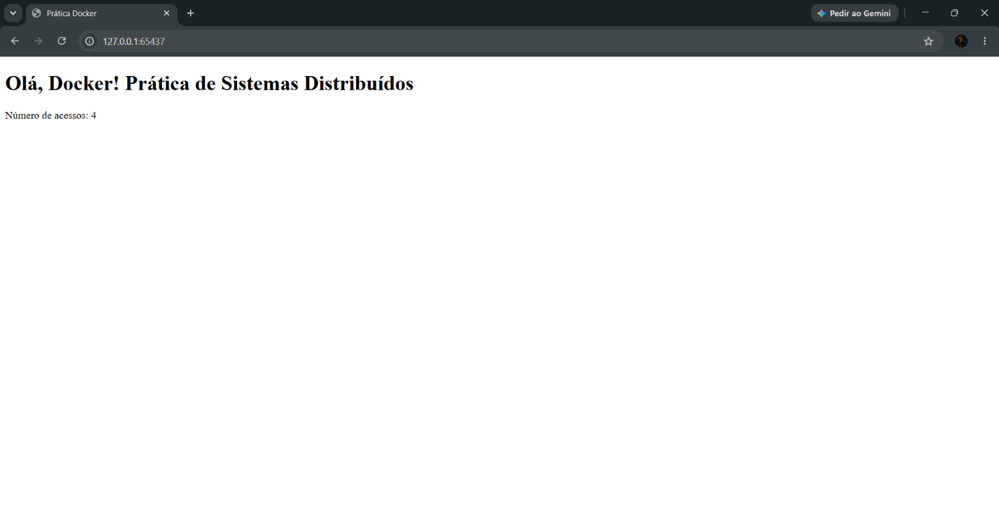
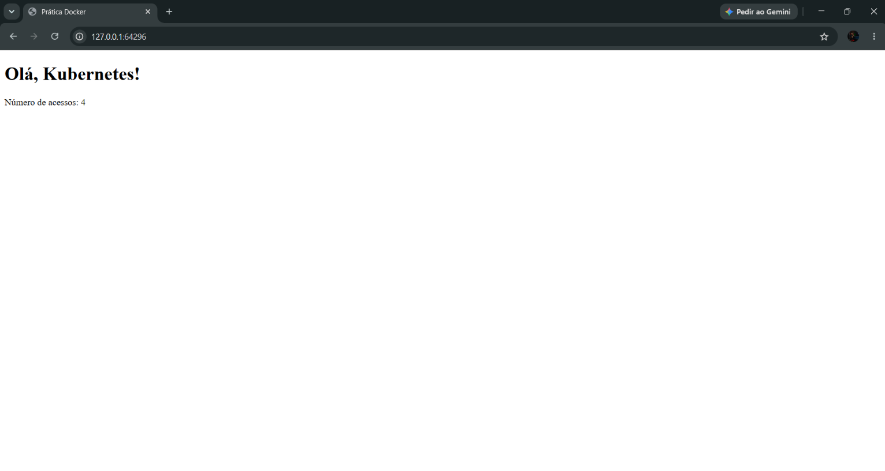

# Prática 2 – Kubernetes (Sistemas Distribuídos)

**Universidade Federal do Ceará – Campus de Crateús**
**Disciplina:** Sistemas Distribuídos 

**Professor:** Anderson Almada

**Aluno(a):** Francisco Dagoberto 

Implantação e gerenciamento, com **Kubernetes (Minikube)**, de uma aplicação **Flask** que contabiliza o número de acessos usando o **Redis**. A aplicação é a mesma da Primeira Prática (que usava Docker Compose).

> 🎥 **Vídeo de demonstração:** [Prática 2 — Sistemas Distribuídos | Ciência da Computação — UFC Crateús](https://youtu.be/_SFxgOYtsaI)

---

## Sumário

1. [Arquitetura](#arquitetura)
2. [Estrutura do repositório](#estrutura-do-repositório)
3. [Pré-requisitos](#pré-requisitos)
4. [Passo a passo](#passo-a-passo)
   1. [Iniciar o cluster](#1-iniciar-o-cluster)
   2. [Construir a imagem](#2-construir-a-imagem-no-minikube)
   3. [Manifestos](#3-manifestos-kubernetes)
   4. [Aplicar e acessar](#4-aplicar-e-acessar-a-aplicação)
   5. [Escalar](#5-escalar-a-aplicação)
   6. [Self-healing](#6-self-healing)
   7. [Rolling update](#7-rolling-update)
   8. [Rollback](#8-rollback)
5. [Respostas das questões](#respostas-das-questões)
6. [Limitações](#limitações)
7. [Solução de problemas](#solução-de-problemas)
8. [Comandos úteis](#comandos-úteis)

---

## Arquitetura

Na Primeira Prática o fluxo era `Navegador → Flask/App → Redis → Volume` (Docker Compose). Agora a aplicação roda em um cluster Kubernetes para permitir várias instâncias, balanceamento de carga, recuperação automática, escalabilidade e atualizações sem interrupção.

```
Navegador
   |
   v   (porta NodePort exposta pelo Minikube)
[Service contador]   tipo NodePort, porta 5050, selector app=contador
   |      |      |         <- balanceia entre os Pods
   v      v      v
[Pod Flask] [Pod Flask] [Pod Flask]    Deployment contador-deployment (3 réplicas)
   \       |       /
    \      |      /    usam o host "redis" (DNS do cluster)
     v     v     v
   [Service redis]   tipo ClusterIP, porta 6379, selector app=redis
          |
          v
     [Pod Redis]     Deployment redis-deployment (1 réplica)
```

| Objeto | Nome | Função |
|---|---|---|
| Deployment | `contador-deployment` | Executa 3 réplicas do Flask (`contador:1.0`) |
| Deployment | `redis-deployment` | Executa 1 réplica do Redis (`redis:latest`) |
| Service (ClusterIP) | `redis` | Ponto de acesso estável ao Redis (porta 6379) |
| Service (NodePort) | `contador` | Expõe a aplicação para fora do cluster (porta 5050) |

---

## Estrutura do repositório

```
pratica-kubernetes/
├── app.py                    # aplicação Flask (da Primeira Prática)
├── requirements.txt
├── Dockerfile
├── k8s/
│   ├── app-deployment.yaml
│   ├── redis-deployment.yaml
│   ├── redis-service.yaml
│   └── app-service.yaml
├── docs/
│   ├── img/                  # prints de cada etapa
│   └── respostas.md          # (opcional) respostas das 9 questões
├── .gitignore
└── README.md
```

---

## Pré-requisitos

- Docker (ou outro driver compatível com o Minikube)
- [Minikube](https://minikube.sigs.k8s.io/)
- [kubectl](https://kubernetes.io/docs/tasks/tools/)
- Git

```bash
docker --version
minikube version
kubectl version --client
git --version
```

> Se o `kubectl` não estiver instalado separadamente, use `minikube kubectl -- <comando>` no lugar de `kubectl <comando>` (ou crie o alias `alias kubectl="minikube kubectl --"`).

---

## Aplicação

A aplicação Flask incrementa um contador no Redis a cada acesso. Pontos importantes para rodar no Kubernetes:

1. O host do Redis vem da variável de ambiente **`REDIS_HOST`**.
2. O Flask escuta em **`0.0.0.0`**, na porta **5050**.

**`app.py`**

```python
from flask import Flask
import redis
import os

app = Flask(__name__)

# Nome do host do Redis
redis_host = os.getenv("REDIS_HOST", "localhost")

# Conexão com o Redis
r = redis.Redis(
    host=redis_host,
    port=6379,
    decode_responses=True
)

@app.route("/")
def home():
    # Incrementa o número de acessos
    acessos = r.incr("acessos")

    return f"""
    <!DOCTYPE html>
    <html lang="pt-BR">
    <head>
        <meta charset="UTF-8">
        <title>Prática Docker</title>
    </head>
    <body>
        <h1>Olá, Docker! Prática de Sistemas Distribuídos</h1>
        <p>Número de acessos: {acessos}</p>
    </body>
    </html>
    """

if __name__ == "__main__":
    app.run(host="0.0.0.0", port=5050)

```

`requirements.txt`:

```
flask
redis
```

`Dockerfile`:

```dockerfile
# Imagem base Python 
FROM python:3.9-slim

# Diretório de trabalho dentro do container 
WORKDIR /app 

# Copiar dependências e instalá-las 
COPY requirements.txt . 
RUN pip install --no-cache-dir -r requirements.txt 

# Copiar os arquivos da aplicação 
COPY . . 

# Expor a porta padrão do Flask 
EXPOSE 5050 

# Comando para iniciar a aplicação 
CMD ["python", "app.py"]
```

> Ajuste este trecho se o seu `app.py` da Primeira Prática for diferente (por exemplo, outra porta).

---

## Passo a passo

> As saídas mostradas são **exemplos**: nomes de Pods (sufixos aleatórios), IPs, portas NodePort e tempos serão diferentes em cada máquina.

### 1. Iniciar o cluster

```bash
minikube start
```

```bash
kubectl get nodes
```
listar os nós (Nodes) do seu cluster Kubernetes e verificar o estado deles.
Node é uma máquina que participa do cluster Kubernetes e pode executar aplicações dentro de Pods. Pode ser uma máquina física ou virtual.

Um Pod é a menor unidade que o Kubernetes consegue criar e gerenciar para executar uma aplicação.
Saída esperada:

```
NAME       STATUS   ROLES           AGE   VERSION
minikube   Ready    control-plane   1m    vX.XX.X
```

O **nó (node)** é uma máquina, física ou virtual, que faz parte do cluster e fornece CPU, memória e rede para executar os Pods. `STATUS Ready` indica que está pronto para receber Pods. No Minikube existe um único nó, que também faz o papel de plano de controle (`control-plane`).


### 2. Construir a imagem no Minikube

O Minikube roda em um ambiente isolado e não enxerga as imagens do Docker local, então a imagem precisa ser construída **dentro** dele.

#### na pasta onde está o Dockerfile
```bash
minikube image build -t contador:1.0 .
```
Serve para construir uma imagem Docker diretamente no ambiente do Minikube, para que o Kubernetes possa utilizá-la ao criar os Pods da sua aplicação.

```bash
minikube image ls 
```

Saída esperada:

```
docker.io/library/contador:1.0
```


### 3. Manifestos Kubernetes

Os 4 arquivos ficam na pasta `k8s/`.

| Arquivo | Função |
|---|---|
| `app-deployment.yaml` | 3 réplicas do Flask, variável `REDIS_HOST=redis` |
| `redis-deployment.yaml` | 1 réplica do Redis |
| `redis-service.yaml` | Service `redis` (ClusterIP, porta 6379) |
| `app-service.yaml` | Service `contador` (NodePort, porta 5050) |

**`k8s/app-deployment.yaml`**

```yaml

apiVersion: apps/v1                 # Define a versão da API do Kubernetes usada para criar o Deployment
kind: Deployment                    # Informa que o recurso criado será um Deployment

metadata:                           # Inicia os metadados do recurso
  name: contador-deployment         # Define o nome do Deployment, usado para identificá-lo nos comandos kubectl

spec:                               # Inicia a especificação do comportamento desejado do Deployment
  replicas: 3                       # Define que o Kubernetes deve manter 3 Pods da aplicação

  selector:                         # Define como o Deployment identifica os Pods que gerencia
    matchLabels:                    # Informa que a seleção será feita por meio de labels
      app: contador                 # Seleciona Pods que possuem a label app=contador

  template:                         # Define o modelo usado para criar cada Pod
    metadata:                       # Inicia os metadados dos Pods que serão criados
      labels:                       # Define as labels que serão adicionadas aos Pods
        app: contador               # Adiciona a label app=contador, que deve corresponder ao selector

    spec:                           # Define a especificação dos contêineres que existirão em cada Pod
      containers:                   # Inicia a lista de contêineres do Pod
        - name: contador            # Define o nome do contêiner dentro do Pod
          image: contador:2.0       # Informa que o contêiner será criado usando a imagem contador, versão 2.0
          imagePullPolicy: IfNotPresent  # Usa a imagem local se ela já existir; caso contrário, tenta obtê-la de um registro

          ports:                    # Inicia a lista de portas declaradas para o contêiner
            - containerPort: 5050    # Declara a porta 5050 em que a aplicação espera receber conexões

          env:                      # Inicia a lista de variáveis de ambiente do contêiner
            - name: REDIS_HOST      # Define o nome da variável de ambiente que a aplicação utilizará
              value: "redis"        # Define redis como o endereço do Redis, normalmente o nome do Service Kubernetes
      # DNS do Service do Redis
```

**`k8s/redis-deployment.yaml`**

```yaml

apiVersion: apps/v1                 # Define a versão da API do Kubernetes usada para criar o Deployment

kind: Deployment                    # Informa que o recurso criado será um Deployment

metadata:                           # Inicia os metadados do recurso
  name: redis-deployment            # Define o nome do Deployment do Redis

spec:                               # Inicia a especificação do estado desejado do Deployment
  replicas: 1                       # Define que o Kubernetes deve manter 1 Pod do Redis

  selector:                         # Define como o Deployment identifica os Pods que gerencia
    matchLabels:                    # Especifica que a seleção será feita por meio de labels
      app: redis                    # Seleciona os Pods que possuem a label app=redis

  template:                         # Define o modelo utilizado para criar os Pods
    metadata:                       # Inicia os metadados dos Pods
      labels:                       # Define as labels que serão atribuídas aos Pods
        app: redis                  # Adiciona a label app=redis, utilizada pelo selector e pelo Service do Redis

    spec:                           # Define a especificação dos contêineres do Pod
      containers:                   # Inicia a lista de contêineres que serão executados no Pod
        - name: redis               # Define o nome do contêiner como redis
          image: redis:latest       # Especifica a imagem oficial do Redis com a tag latest

          ports:                    # Inicia a lista de portas declaradas para o contêiner
            - containerPort: 6379    # Declara a porta padrão do Redis, usada para receber conexões

```

**`k8s/redis-service.yaml`**

```yaml

apiVersion: v1                      # Define a versão da API do Kubernetes utilizada para criar o Service

kind: Service                       # Informa que o recurso criado será um Service

metadata:                           # Inicia os metadados do recurso
  name: redis                       # Define o nome do Service; normalmente, esse nome também será o DNS "redis" no cluster

spec:                               # Inicia a especificação de funcionamento do Service
  selector:                         # Define quais Pods receberão o tráfego encaminhado pelo Service
    app: redis                      # Seleciona os Pods que possuem a label app=redis

  ports:                            # Inicia a lista de portas disponibilizadas pelo Service
    - port: 6379                    # Define a porta pela qual outros recursos acessam o Service
      targetPort: 6379              # Define a porta de destino no Pod, onde o Redis recebe conexões

```

**`k8s/app-service.yaml`**

```yaml

apiVersion: v1                      # Define a versão da API do Kubernetes utilizada para criar o Service

kind: Service                       # Informa que o recurso criado será um Service

metadata:                           # Inicia os metadados do recurso
  name: redis                       # Define o nome do Service; normalmente, esse nome também será o DNS "redis" no cluster

spec:                               # Inicia a especificação de funcionamento do Service
  selector:                         # Define quais Pods receberão o tráfego encaminhado pelo Service
    app: redis                      # Seleciona os Pods que possuem a label app=redis

  ports:                            # Inicia a lista de portas disponibilizadas pelo Service
    - port: 6379                    # Define a porta pela qual outros recursos acessam o Service
      targetPort: 6379              # Define a porta de destino no Pod, onde o Redis recebe conexões

```


### 4. Aplicar e acessar a aplicação
No Terminal: 
```bash
kubectl apply -f k8s/
```
Saída esperada:
```
deployment.apps/contador-deployment created
service/contador created
deployment.apps/redis-deployment created
service/redis created
```


Verificação dos recursos (esperado: 3 Pods do app + 1 do Redis, 2 Deployments e 2 Services):

No Terminal: 
```bash
kubectl get pods
```
Saída Esperada
```
NAME                                   READY   STATUS    RESTARTS   AGE
contador-deployment-7d9c8b6f5d-4kq2x   1/1     Running   0          25s
contador-deployment-7d9c8b6f5d-9wz7p   1/1     Running   0          25s
contador-deployment-7d9c8b6f5d-hv5tn   1/1     Running   0          25s
redis-deployment-5c6b7f9d8-m8z2p       1/1     Running   0          25s
```
No Terminal
```bash
kubectl get deployments
```
Saída esperada:
```
NAME                  READY   UP-TO-DATE   AVAILABLE   AGE
contador-deployment   3/3     3            3           30s
redis-deployment      1/1     1            1           30s
```

No Terminal
```bash
kubectl get services
```

Saída esperada:
```
NAME         TYPE        CLUSTER-IP      EXTERNAL-IP   PORT(S)          AGE
contador     NodePort    10.101.x.x      <none>        5050:3xxxx/TCP   35s
kubernetes   ClusterIP   10.96.0.1       <none>        443/TCP          6m
redis        ClusterIP   10.108.x.x      <none>        6379/TCP         35s
```

Como ler: `READY 1/1` indica que o container do Pod está pronto; `3/3` no Deployment indica que as 3 réplicas desejadas estão disponíveis; em `PORT(S)`, `5050:3xxxx` significa porta 5050 do Service mapeada para uma porta alta (NodePort) no nó. O Service `kubernetes` pertence ao próprio cluster.


Comandos para entender a ligação entre Services e Pods:

No Terminal:
```bash
kubectl get pods --show-labels
```
```bash
kubectl get endpoints contador
```

```bash
kubectl get endpoints redis
```
```bash
kubectl describe service contador
```
```bash
kubectl get pods -o wide
```
- 
Acesso pelo navegador:
No Terminal
```bash
minikube service contador --url
```


http://127.0.0.1:65437


Abra a URL e atualize a página várias vezes: o contador aumenta e o nome do Pod alterna entre as réplicas, evidenciando o balanceamento de carga.

> Dependendo do driver (Docker no Windows/macOS), o comando usa uma porta local (ex.: `127.0.0.1:xxxxx`) e o terminal precisa ficar aberto.



### 5. Escalar a aplicação

Aumentar para 5 réplicas:

No Terminal:

```bash
kubectl scale deployment contador-deployment --replicas=5
```

Saída Esperada:
```
deployment.apps/contador-deployment scaled
```
No Terminal:
```bash
kubectl get pods
```
Saída Esperada:
```
NAME                                   READY   STATUS              RESTARTS   AGE
contador-deployment-7d9c8b6f5d-4kq2x   1/1     Running             0          6m
contador-deployment-7d9c8b6f5d-9wz7p   1/1     Running             0          6m
contador-deployment-7d9c8b6f5d-hv5tn   1/1     Running             0          6m
contador-deployment-7d9c8b6f5d-p2c8d   0/1     ContainerCreating   0          2s
contador-deployment-7d9c8b6f5d-x6jlf   0/1     ContainerCreating   0          2s
redis-deployment-5c6b7f9d8-m8z2p       1/1     Running             0          6m
```


Reduzir para 2 réplicas:

No Terminal: 
```bash
kubectl scale deployment contador-deployment --replicas=2
```
```bash
kubectl get pods
```
Saída Esperada:
```
NAME                                   READY   STATUS        RESTARTS   AGE
contador-deployment-7d9c8b6f5d-4kq2x   1/1     Running       0          7m
contador-deployment-7d9c8b6f5d-9wz7p   1/1     Running       0          7m
contador-deployment-7d9c8b6f5d-hv5tn   1/1     Terminating   0          7m
contador-deployment-7d9c8b6f5d-p2c8d   1/1     Terminating   0          1m
contador-deployment-7d9c8b6f5d-x6jlf   1/1     Terminating   0          1m
redis-deployment-5c6b7f9d8-m8z2p       1/1     Running       0          7m
```


Escalar é apenas alterar o número desejado de réplicas: o Deployment (via ReplicaSet) cria ou remove Pods até chegar nesse número. O navegador continua funcionando durante o processo, pois o contador está no Redis, que não foi alterado.

### 6. Self-healing
No Terminal: 
```bash
kubectl get pods
```

```bash
kubectl delete pod <nome-do-pod>
```

```bash
kubectl get pods
```

Saída Esperada
```
NAME                                   READY   STATUS              RESTARTS   AGE
contador-deployment-7d9c8b6f5d-4kq2x   1/1     Terminating         0          9m
contador-deployment-7d9c8b6f5d-9wz7p   1/1     Running             0          9m
contador-deployment-7d9c8b6f5d-b4m9q   0/1     ContainerCreating   0          1s
redis-deployment-5c6b7f9d8-m8z2p       1/1     Running             0          9m
```

Um Pod **novo**, com nome diferente e poucos segundos de vida, é criado para substituir o removido, e o total de Pods volta ao estado desejado.


### 7. Rolling update

`app.py` Antes:

```python
from flask import Flask
import redis
import os

app = Flask(__name__)

# Nome do host do Redis
redis_host = os.getenv("REDIS_HOST", "localhost")

# Conexão com o Redis
r = redis.Redis(
    host=redis_host,
    port=6379,
    decode_responses=True
)

@app.route("/")
def home():
    # Incrementa o número de acessos
    acessos = r.incr("acessos")

    return f"""
    <!DOCTYPE html>
    <html lang="pt-BR">
    <head>
        <meta charset="UTF-8">
        <title>Prática Docker</title>
    </head>
    <body>
        <h1>Olá, Docker! Prática de Sistemas Distribuídos</h1>
        <p>Número de acessos: {acessos}</p>
    </body>
    </html>
    """

if __name__ == "__main__":
    app.run(host="0.0.0.0", port=5050)

```

`app.py` Depois:

```python
from flask import Flask
import redis
import os

app = Flask(__name__)

# Nome do host do Redis
redis_host = os.getenv("REDIS_HOST", "localhost")

# Conexão com o Redis
r = redis.Redis(
    host=redis_host,
    port=6379,
    decode_responses=True
)

@app.route("/")
def home():
    # Incrementa o número de acessos
    acessos = r.incr("acessos")

    return f"""
    <!DOCTYPE html>
    <html lang="pt-BR">
    <head>
        <meta charset="UTF-8">
        <title>Prática Docker</title>
    </head>
    <body>
        <h1>Olá, Kubernetes!</h1>
        <p>Número de acessos: {acessos}</p>
    </body>
    </html>
    """

if __name__ == "__main__":
    app.run(host="0.0.0.0", port=5050)

```


**7.1 Alterar a mensagem** em `app.py`:

Antes:
```html
 <body>
      <h1>Olá, Docker! Prática de Sistemas Distribuídos</h1>
      <p>Número de acessos: {acessos}</p>
  </body>
```

Depois:
```html
   <body>
        <h1>Olá, Kubernetes!</h1>
        <p>Número de acessos: {acessos}</p>
    </body>
```

**7.2 Construir a imagem 2.0:**

No Terminal:
```bash
minikube image build -t contador:2.0 .
```

```bash
minikube image ls 
```
Saída Esperada
```
docker.io/library/contador:1.0
docker.io/library/contador:2.0
```

**7.3 Trocar a imagem** em `k8s/app-deployment.yaml`:

Na linha 17, Antes

```yaml
image: contador:1.0
```
Na linha 17, Depois
```yaml
image: contador:2.0
```

Opcionalmente, a estratégia pode ser declarada explicitamente dentro de `spec`:

```yaml
spec:
  replicas: 3
  strategy:
    type: RollingUpdate
    rollingUpdate:
      maxSurge: 1          # até 1 Pod a mais que o desejado durante a troca
      maxUnavailable: 0    # nenhum Pod pode ficar indisponível
```

**7.4 Aplicar e acompanhar** (em outro terminal, `kubectl get pods -w` mostra Pods antigos e novos convivendo):

No Terminal: 
```bash
kubectl apply -f k8s/app-deployment.yaml
```
Saída Esperada: 
```
deployment.apps/contador-deployment configured
```

Acesso pelo navegador:
No Terminal
```bash
minikube service contador --url
```


http://127.0.0.1:65437



No Terminal: 
```bash
kubectl rollout status deployment/contador-deployment
```

```
Waiting for deployment "contador-deployment" rollout to finish: 1 out of 3 new replicas have been updated...
Waiting for deployment "contador-deployment" rollout to finish: 2 out of 3 new replicas have been updated...
Waiting for deployment "contador-deployment" rollout to finish: 1 old replicas are pending termination...
deployment "contador-deployment" successfully rolled out
```


**7.5 Pods, histórico e navegador:**

```bash
kubectl get pods
```
```bash
kubectl rollout history deployment/contador-deployment
```
Saída Esperada:

```
deployment.apps/contador-deployment
REVISION  CHANGE-CAUSE
1         <none>
2         <none>
```
```bash
kubectl rollout history deployment/contador-deployment --revision=2
```

(Opcional) para preencher a coluna `CHANGE-CAUSE`:

```bash
kubectl annotate deployment/contador-deployment kubernetes.io/change-cause="atualiza para 2.0"
```


### 8. Rollback
No Terminal:
```bash
kubectl rollout undo deployment/contador-deployment
```
```bash
kubectl rollout status deployment/contador-deployment
```
```bash
kubectl get pods
```
- 
```bash
kubectl rollout history deployment/contador-deployment
```

Saída Esperada:
```
deployment.apps/contador-deployment rolled back
...
deployment "contador-deployment" successfully rolled out

REVISION  CHANGE-CAUSE
2         <none>
3         <none>
```
Acesso pelo navegador:
No Terminal
```bash
minikube service contador --url
```

Aparecem as revisões 2 e 3 porque o rollback volta ao conteúdo da revisão 1 (imagem `1.0`), mas o Kubernetes registra isso como uma **nova** revisão (3) e remove a antiga 1 da lista. Para confirmar a imagem em uso:

```bash
kubectl describe deployment contador-deployment
```


> ⚠️ O rollback altera **apenas o cluster**. O arquivo `k8s/app-deployment.yaml` continua com `contador:2.0`; se `kubectl apply` for executado novamente, a versão 2.0 volta. Para o repositório refletir o que está rodando, basta voltar a linha da imagem para `contador:1.0` e fazer um commit.

---

## Respostas das questões

> _Revise e reescreva com suas próprias palavras, citando o que você observou nos seus comandos (nomes de Pods, saídas do `kubectl`)._

**Questão 1 – O que representa o nó apresentado pelo comando `kubectl get nodes`?**
O nó (node) é uma máquina, física ou virtual, que faz parte do cluster e fornece CPU, memória e rede para executar os Pods. No Minikube existe um único nó (chamado `minikube`), que acumula os papéis de plano de controle e de trabalhador. Em produção haveria vários nós.

**Questão 2 – Por que usar `redis` em `REDIS_HOST` em vez do IP de um Pod Redis?**
Pods são efêmeros: se forem recriados, ganham outro IP, e um IP fixo no código quebraria a aplicação. O nome `redis` é o nome do Service, resolvido pelo DNS interno do cluster para um endereço estável, que sempre leva ao Pod Redis atual.

**Questão 3 – Por que a aplicação tem 3 réplicas e o Redis apenas 1?**
O Flask é *stateless* (não guarda o contador) e pode ser replicado livremente para dividir carga e dar tolerância a falhas. O Redis guarda o estado (o valor do contador): com 2 ou mais instâncias independentes, cada uma teria seu próprio valor e o contador ficaria inconsistente. Replicar um banco exige configuração específica (replicação, cluster, StatefulSet), fora do escopo desta prática.

**Questão 4 – Qual é a função do Service do Redis?**
Fornecer um ponto de acesso estável (nome DNS `redis`, IP virtual e porta 6379) aos Pods do Redis, cujos IPs podem mudar. Ele usa o selector `app: redis` para descobrir os Pods e encaminha o tráfego a eles. Por ser ClusterIP, só é acessível dentro do cluster.

**Questão 5 – Como o Service `contador` sabe quais Pods devem receber as requisições?**
Pelo **selector** de labels. O Service declara `app: contador`; o Kubernetes mantém a lista (Endpoints) dos Pods que possuem essa label e estão prontos, e distribui as requisições entre eles (visível com `kubectl get endpoints contador`).

**Questão 6 – O que aconteceu com os Pods quando as réplicas foram de 3 para 5 e depois para 2?**
Ao passar para 5, o Deployment (via ReplicaSet) criou 2 Pods novos até atingir o estado desejado. Ao reduzir para 2, encerrou 3 Pods (ficaram em `Terminating` e sumiram). O Service passa a balancear entre os Pods existentes em cada momento.

**Questão 7 – O Pod removido foi simplesmente perdido?**
Não. O ReplicaSet percebeu que o estado atual estava abaixo do desejado e criou imediatamente um Pod substituto, com novo nome e novo IP. Isso é *self-healing*: o Kubernetes reconcilia continuamente o estado atual com o desejado.

**Questão 8 – O que caracteriza um Rolling Update? Por que é útil em aplicações que precisam permanecer disponíveis?**
Os Pods da versão antiga são substituídos **gradualmente** pelos da nova (sobem alguns novos e só depois removem alguns antigos), controlado por parâmetros como `maxSurge` e `maxUnavailable`. Assim sempre há Pods atendendo, evitando indisponibilidade durante a atualização, e problemas podem ser detectados cedo e revertidos.

**Questão 9 – Qual é a função do comando `kubectl rollout undo`?**
Reverter o Deployment para a revisão anterior (por padrão, a imediatamente anterior), também por meio de um rolling update. É a forma rápida de se recuperar de uma atualização com problema; outra revisão pode ser escolhida com `--to-revision=N`.

---

## Limitações

O Redis roda com **1 réplica e sem volume persistente**: se o Pod do Redis for apagado ou recriado, o contador pode voltar a zero. Um `PersistentVolumeClaim` resolveria esse ponto, mas não faz parte do escopo desta prática.

---

## Solução de problemas

| Sintoma | Causa provável | O que fazer |
|---|---|---|
| `ErrImagePull` / `ImagePullBackOff` | Imagem não existe no Minikube ou o pull tenta a internet | `minikube image ls \| grep contador`; refaça o build; confirme `imagePullPolicy: IfNotPresent` e o nome/tag exatos |
| `CrashLoopBackOff` | App caiu ao iniciar (erro de código, Redis inacessível, variável incorreta) | `kubectl logs <pod>` e `kubectl describe pod <pod>` |
| `Pending` | Falta de recursos no nó | `kubectl describe pod <pod>` (veja *Events*); reduza réplicas ou aumente recursos do Minikube |
| Página não abre | `targetPort` errada, selector que não bate ou terminal do `minikube service` fechado | `kubectl get endpoints contador` (vazio = selector errado); mantenha o terminal aberto |
| Erro de conexão com o Redis | `REDIS_HOST` diferente do nome do Service, ou o app ignora a variável | Confira o Service `redis`, o `env` do Deployment e o `app.py`; veja os logs |
| Mudança no código não aparece | A tag da imagem não mudou ou o YAML não foi alterado | Construa com tag nova (2.0), altere o YAML e rode o `apply` |
| Erro de YAML | Indentação, TAB ou campo digitado errado | Use espaços; rode `kubectl apply --dry-run=client -f k8s/` |

---

## Comandos úteis

```bash
kubectl get all                              # visão geral
kubectl describe pod <pod>                   # eventos e detalhes
kubectl logs <pod>                           # logs
kubectl logs -l app=contador --prefix        # logs de todos os Pods do app
kubectl delete -f k8s/                       # remove os recursos criados
minikube stop                                # para o cluster
minikube delete                              # apaga o cluster (recomeço do zero)
```

1. Remover só os recursos da prática (o cluster continua)

```bash
kubectl delete -f k8s/
```
Isso apaga os 2 Deployments, os 2 Services e, com eles, todos os Pods. Para conferir:

```bash
kubectl get all
```

Deve sobrar apenas o Service kubernetes, que é do próprio cluster.

2. Remover as imagens do Minikube (opcional)

```bash
minikube image rm contador:1.0
```

```bash
minikube image rm contador:2.0
```

3. Apagar o cluster inteiro (recomeço do zero)

```bash
minikube stop
```
#### só para o cluster, sem apagar nada
```bash
minikube delete    
```
#### apaga o cluster, incluindo Pods, imagens e configurações dele

Para apagar também todos os clusters e o cache do Minikube:

```bash
minikube delete --all --purge
```

O --purge remove a pasta ~/.minikube. Depois disso, um novo minikube start baixa tudo de novo e demora mais.

Se você usou o driver Docker, o minikube delete já remove o container do Minikube. Para ver se sobrou algo no Docker:

```bash
docker ps -a
```
```bash
docker images
```

Se quiser liberar espaço no Docker (cuidado: isso apaga todos os containers parados, redes e imagens sem uso, inclusive de outros projetos):