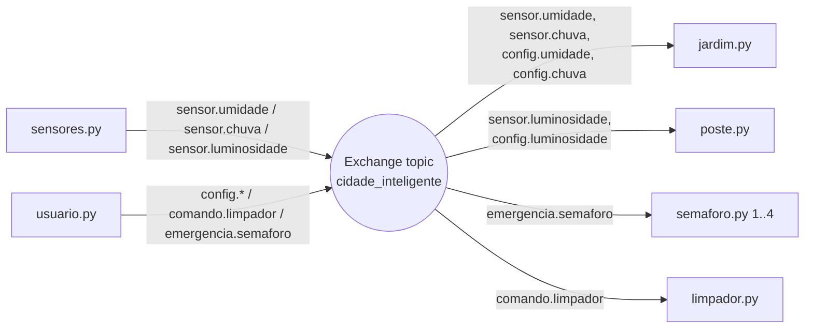

# 🏙️ Quinta Prática — Cidade Inteligente com RabbitMQ

**Universidade Federal do Ceará — Campus de Crateús**
**Disciplina:** Sistemas Distribuídos
**Professor:** Anderson Almada

Aplicação de uma **cidade inteligente** em que **sensores** publicam dados e **objetos inteligentes** (semáforo, limpador de ruas, lâmpada de poste e jardim) reagem a eles, tudo comunicado por **RabbitMQ** usando o mecanismo **Pub/Sub**.

---

## 📑 Sumário

1. [Requisitos do enunciado](#1-requisitos-do-enunciado)
2. [Arquitetura da solução](#2-arquitetura-da-solução)
3. [Estrutura do projeto](#3-estrutura-do-projeto)
4. [Pré-requisitos](#4-pré-requisitos)
5. [Passo 1 — Subir o RabbitMQ](#passo-1--subir-o-rabbitmq)
6. [Passo 2 — Preparar o ambiente Python](#passo-2--preparar-o-ambiente-python)
7. [Passo 3 — Testar o Producer/Consumer base](#passo-3--testar-o-producerconsumer-base)
8. [Passo 4 — Da fila simples para o Pub/Sub](#passo-4--da-fila-simples-para-o-pubsub)
9. [Passo 5 — Módulo comum (`common.py`)](#passo-5--módulo-comum-commonpy)
10. [Passo 6 — Objetos inteligentes](#passo-6--objetos-inteligentes)
11. [Passo 7 — Sensores simulados](#passo-7--sensores-simulados)
12. [Passo 8 — Painel do usuário](#passo-8--painel-do-usuário)
13. [Passo 9 — Executando tudo](#passo-9--executando-tudo)
14. [Passo 10 — Cenários de teste](#passo-10--cenários-de-teste)
15. [Painel web do RabbitMQ](#painel-web-do-rabbitmq)
16. [Problemas comuns](#problemas-comuns)
17. [Entrega do projeto](#entrega-do-projeto)
18. [Roteiro sugerido para o vídeo](#roteiro-sugerido-para-o-vídeo)

---

## 1. Requisitos do enunciado

| # | Requisito | Como foi atendido |
|---|-----------|-------------------|
| 1 | Jardim: o usuário define limites de **chuva** e **umidade**; se **detectar chuva** e a **umidade do solo** for **menor** que o limite, o jardim é ativado e libera chuva ao solo. Caso contrário, nada é ajustado. | `jardim.py` guarda os limites e os últimos valores dos sensores e avalia a regra a cada nova mensagem |
| 2 | Semáforo: quando um veículo de urgência precisa avançar, os **demais** semáforos ficam **vermelhos**. | `semaforo.py` (várias instâncias) escuta o tópico de emergência |
| 3 | Lâmpada do poste: luminosidade (lux) definida pelo usuário é armazenada; se o sensor medir **menos de 100 lux**, a lâmpada liga. Caso contrário, nada é ajustado. | `poste.py` guarda o limite (padrão **100**) e compara com o sensor |
| 4 | Limpador de ruas: comando **LIGA** inicia a limpeza e **DESLIGA** encerra. | `limpador.py` recebe os comandos do usuário |
| 5 | Sensores **simulados** pelo usuário | `sensores.py` (menu interativo) |
| 6 | Usar **Pub/Sub** do RabbitMQ | Exchange do tipo **topic** + filas exclusivas por consumidor |
| 7 | Entregar zip/GitHub + vídeo | Veja [Entrega do projeto](#entrega-do-projeto) |

> **Interpretações adotadas** (o enunciado deixa em aberto):
> - **Chuva** é um valor numérico de intensidade (0 a 100). "Detectou chuva" significa `chuva >= limite_chuva`.
> - **Umidade** é a umidade do solo em % (0 a 100).
> - **Luminosidade**: o limite começa em **100 lux** (valor do enunciado) e o usuário pode alterá-lo; a lâmpada liga quando `lux < limite`.

---

## 2. Arquitetura da solução

Todos os componentes se conectam a **um único exchange** chamado `cidade_inteligente` (tipo **topic**). Quem publica só informa uma **routing key**; quem consome cria uma fila própria e a "liga" (bind) às routing keys que lhe interessam.



### Routing keys

| Routing key | Quem publica | Quem consome | Conteúdo da mensagem |
|-------------|--------------|--------------|----------------------|
| `sensor.umidade` | sensores | jardim | número (0–100) |
| `sensor.chuva` | sensores | jardim | número (0–100) |
| `sensor.luminosidade` | sensores | poste | número em lux |
| `config.umidade` | usuário | jardim | limite de umidade |
| `config.chuva` | usuário | jardim | limite de chuva |
| `config.luminosidade` | usuário | poste | limite de lux |
| `comando.limpador` | usuário | limpador | `LIGA` ou `DESLIGA` |
| `emergencia.semaforo` | usuário | semáforos | id do semáforo que deve passar (ex.: `1`) ou `FIM` |

---

## 3. Estrutura do projeto

```
smart-city/
├── base/
│   ├── producer.py        # exemplo base (fila simples)
│   └── consumer.py        # exemplo base (fila simples)
├── common.py              # conexão e funções de Pub/Sub reutilizáveis
├── jardim.py              # objeto inteligente: Jardim
├── poste.py               # objeto inteligente: Lâmpada do poste
├── semaforo.py            # objeto inteligente: Semáforo (várias instâncias)
├── limpador.py            # objeto inteligente: Limpador das ruas
├── sensores.py            # simulador dos 3 sensores
├── usuario.py             # painel do usuário (limites e comandos)
├── requirements.txt
└── README.md
```

Crie a estrutura:

```bash
mkdir smart-city
cd smart-city
mkdir base
```

---

## 4. Pré-requisitos

- **Python 3.9+** → verifique com `python --version` (ou `python3 --version`)
- **Docker** → verifique com `docker --version`
- Biblioteca Python **pika**

---

## Passo 1 — Subir o RabbitMQ

A forma mais simples é usar Docker (já com o painel de gerenciamento):

```bash
docker run -d --name rabbitmq -p 5672:5672 -p 15672:15672 rabbitmq:3-management
```

- `5672` → porta usada pelos programas Python (protocolo AMQP)
- `15672` → painel web de gerenciamento

Confirme que está rodando:

```bash
docker ps
```

Aguarde uns 10–20 segundos e acesse **http://localhost:15672** (usuário `guest`, senha `guest`).

Comandos úteis:

```bash
docker stop rabbitmq      # parar
docker start rabbitmq     # iniciar de novo
docker logs rabbitmq      # ver logs
docker rm -f rabbitmq     # remover o contêiner
```

> **Sem Docker?** Instale o RabbitMQ localmente (https://www.rabbitmq.com/docs/download). No Ubuntu/Debian: `sudo apt install rabbitmq-server` e depois `sudo rabbitmq-plugins enable rabbitmq_management`.

---

## Passo 2 — Preparar o ambiente Python

Dentro da pasta `smart-city`:

**Linux / macOS**

```bash
python3 -m venv venv
source venv/bin/activate
```

**Windows (PowerShell)**

```powershell
python -m venv venv
venv\Scripts\Activate.ps1
```

Crie o arquivo `requirements.txt`:

```
pika==1.3.2
```

Instale:

```bash
pip install -r requirements.txt
```

---

## Passo 3 — Testar o Producer/Consumer base

Antes de montar a cidade, valide que o RabbitMQ e o `pika` funcionam com os dois códigos base. Eles usam uma **fila simples** (modelo ponto a ponto): o producer envia para a fila `fila_teste` e o consumer lê dela.

### `base/producer.py`

```python
# Producer

import pika

connection = pika.BlockingConnection(
    pika.ConnectionParameters("localhost")
)

channel = connection.channel()

channel.queue_declare(queue="fila_teste", durable=True)

mensagem = "Olá, RabbitMQ!"

channel.basic_publish(
    exchange="",
    routing_key="fila_teste",
    body=mensagem
)

print(f"Mensagem enviada: {mensagem}")

connection.close()
```

### `base/consumer.py`

```python
# Consumer

import pika

connection = pika.BlockingConnection(
    pika.ConnectionParameters("localhost")
)

channel = connection.channel()

channel.queue_declare(queue="fila_teste", durable=True)

def receber_mensagem(ch, method, properties, body):
    print(f"Mensagem recebida: {body.decode()}")

channel.basic_consume(
    queue="fila_teste",
    on_message_callback=receber_mensagem,
    auto_ack=True
)

print("Aguardando mensagens...")

channel.start_consuming()
```

### Executando o teste

**Terminal 1** (consumer):

```bash
python base/consumer.py
```

Saída esperada:

```
Aguardando mensagens...
```

**Terminal 2** (producer):

```bash
python base/producer.py
```

Saída esperada no Terminal 2:

```
Mensagem enviada: Olá, RabbitMQ!
```

E no Terminal 1:

```
Mensagem recebida: Olá, RabbitMQ!
```

✅ Funcionou? Encerre o consumer com `CTRL + C` e siga adiante.

---

## Passo 4 — Da fila simples para o Pub/Sub

Os exemplos base usam o **exchange padrão** (`exchange=""`), em que a mensagem vai direto para **uma** fila e **um** consumidor a recebe. Para uma cidade inteligente precisamos de **Pub/Sub**: o sensor publica e **qualquer** objeto interessado recebe.

| Conceito | Exemplo base | Cidade inteligente |
|----------|--------------|--------------------|
| Exchange | `""` (padrão) | `cidade_inteligente` (tipo **topic**) |
| Fila | `fila_teste` fixa e durável | fila **temporária e exclusiva** por consumidor (`queue=""`, `exclusive=True`) |
| Roteamento | nome da fila | **routing key** (`sensor.umidade`, `comando.limpador`...) |
| Ligação | implícita | `queue_bind(...)` liga a fila às routing keys desejadas |

O que mudou no código:

```python
# Declara o exchange (publisher e consumer fazem isso)
channel.exchange_declare(exchange="cidade_inteligente", exchange_type="topic", durable=True)

# Publisher: publica no exchange com uma routing key
channel.basic_publish(exchange="cidade_inteligente", routing_key="sensor.umidade", body="35")

# Consumer: cria fila própria e a liga à routing key
fila = channel.queue_declare(queue="", exclusive=True).method.queue
channel.queue_bind(exchange="cidade_inteligente", queue=fila, routing_key="sensor.umidade")
channel.basic_consume(queue=fila, on_message_callback=callback, auto_ack=True)
```

---

## Passo 5 — Módulo comum (`common.py`)

Para não repetir código, centralizamos a conexão e as funções de publicar/consumir, mantendo a mesma estrutura dos exemplos base (`BlockingConnection`, `basic_publish`, `basic_consume`, `start_consuming`).

### `common.py`

```python
import pika

EXCHANGE = "cidade_inteligente"


def conectar():
    """Abre conexão com o RabbitMQ e declara o exchange topic."""
    connection = pika.BlockingConnection(
        pika.ConnectionParameters("localhost")
    )
    channel = connection.channel()
    channel.exchange_declare(
        exchange=EXCHANGE,
        exchange_type="topic",
        durable=True
    )
    return connection, channel


def publicar(channel, routing_key, mensagem):
    """Publica uma mensagem no exchange com a routing key informada."""
    channel.basic_publish(
        exchange=EXCHANGE,
        routing_key=routing_key,
        body=str(mensagem)
    )


def criar_consumidor(channel, routing_keys, callback):
    """Cria uma fila exclusiva, liga às routing keys e registra o callback."""
    resultado = channel.queue_declare(queue="", exclusive=True)
    fila = resultado.method.queue

    for rk in routing_keys:
        channel.queue_bind(exchange=EXCHANGE, queue=fila, routing_key=rk)

    channel.basic_consume(
        queue=fila,
        on_message_callback=callback,
        auto_ack=True
    )


def iniciar(channel, nome):
    """Inicia o loop de consumo até o usuário apertar CTRL+C."""
    print(f"[{nome}] Aguardando mensagens... (CTRL+C para sair)")
    try:
        channel.start_consuming()
    except KeyboardInterrupt:
        print(f"\n[{nome}] Encerrado.")
```

---

## Passo 6 — Objetos inteligentes

Cada objeto é um **consumer** (subscriber) independente. Rode cada um em um terminal separado.

### 6.1 Jardim — `jardim.py`

**Regra:** guarda os limites definidos pelo usuário e os últimos valores dos sensores. Se **está chovendo** (`chuva >= limite_chuva`) **e** a umidade do solo está **abaixo** do limite (`umidade < limite_umidade`), o jardim é ativado e libera chuva ao solo. Caso contrário, não faz ajuste.

```python
from common import conectar, criar_consumidor, iniciar

# Estado armazenado (limites iniciais padrão, o usuário pode alterar)
estado = {
    "limite_umidade": 40.0,
    "limite_chuva": 50.0,
    "umidade": None,
    "chuva": None,
}


def avaliar():
    """Aplica a regra do jardim com os dados armazenados."""
    if estado["umidade"] is None or estado["chuva"] is None:
        print("[JARDIM] Aguardando leituras dos dois sensores (umidade e chuva)...")
        return

    chovendo = estado["chuva"] >= estado["limite_chuva"]
    solo_seco = estado["umidade"] < estado["limite_umidade"]

    if chovendo and solo_seco:
        print("[JARDIM] 💧 ATIVADO: chuva detectada e solo seco. Liberando chuva ao solo!")
    else:
        print("[JARDIM] Sem ajuste necessário "
              f"(chovendo={chovendo}, solo_seco={solo_seco}).")


def tratar(ch, method, properties, body):
    chave = method.routing_key

    try:
        valor = float(body.decode())
    except ValueError:
        print(f"[JARDIM] Valor inválido recebido em {chave}: {body.decode()}")
        return

    if chave == "config.umidade":
        estado["limite_umidade"] = valor
        print(f"[JARDIM] Limite de umidade definido: {valor}%")
    elif chave == "config.chuva":
        estado["limite_chuva"] = valor
        print(f"[JARDIM] Limite de chuva definido: {valor}")
    elif chave == "sensor.umidade":
        estado["umidade"] = valor
        print(f"[JARDIM] Sensor de umidade: {valor}%")
        avaliar()
    elif chave == "sensor.chuva":
        estado["chuva"] = valor
        print(f"[JARDIM] Sensor de chuva: {valor}")
        avaliar()


connection, channel = conectar()

criar_consumidor(
    channel,
    ["sensor.umidade", "sensor.chuva", "config.umidade", "config.chuva"],
    tratar
)

iniciar(channel, "JARDIM")
```

### 6.2 Lâmpada do poste — `poste.py`

**Regra:** guarda o limite de luminosidade (padrão **100 lux**, alterável pelo usuário). Se a luminosidade medida for **menor** que o limite, a lâmpada é ativada; caso contrário, não faz ajuste.

```python
from common import conectar, criar_consumidor, iniciar

estado = {"limite_lux": 100.0}


def tratar(ch, method, properties, body):
    chave = method.routing_key

    try:
        valor = float(body.decode())
    except ValueError:
        print(f"[POSTE] Valor inválido recebido em {chave}: {body.decode()}")
        return

    if chave == "config.luminosidade":
        estado["limite_lux"] = valor
        print(f"[POSTE] Limite de luminosidade definido: {valor} lux")

    elif chave == "sensor.luminosidade":
        print(f"[POSTE] Sensor de luminosidade: {valor} lux")
        if valor < estado["limite_lux"]:
            print(f"[POSTE] 💡 LÂMPADA ATIVADA (abaixo de {estado['limite_lux']} lux)")
        else:
            print("[POSTE] Sem ajuste necessário (luminosidade suficiente).")


connection, channel = conectar()

criar_consumidor(
    channel,
    ["sensor.luminosidade", "config.luminosidade"],
    tratar
)

iniciar(channel, "POSTE")
```

### 6.3 Semáforo — `semaforo.py`

**Regra:** cada semáforo é uma instância identificada por um **id** passado na linha de comando. Quando chega uma emergência indicando qual semáforo deve liberar passagem, esse fica **VERDE** e todos os **demais ficam VERMELHOS**. A mensagem `FIM` encerra a emergência e volta à operação normal.

```python
import sys
from common import conectar, criar_consumidor, iniciar

if len(sys.argv) != 2:
    print("Uso: python semaforo.py <id>   (ex.: python semaforo.py 1)")
    sys.exit(1)

meu_id = sys.argv[1].strip().upper()


def tratar(ch, method, properties, body):
    comando = body.decode().strip().upper()

    if comando == "FIM":
        print(f"[SEMÁFORO {meu_id}] ✅ Emergência encerrada. Voltando à operação NORMAL.")
    elif comando == meu_id:
        print(f"[SEMÁFORO {meu_id}] 🟢 VERDE — veículo de urgência avançando!")
    else:
        print(f"[SEMÁFORO {meu_id}] 🔴 VERMELHO — aguardando veículo de urgência "
              f"(prioridade no semáforo {comando}).")


connection, channel = conectar()

criar_consumidor(channel, ["emergencia.semaforo"], tratar)

iniciar(channel, f"SEMÁFORO {meu_id}")
```

### 6.4 Limpador das ruas — `limpador.py`

**Regra:** `LIGA` inicia a limpeza e `DESLIGA` encerra.

```python
from common import conectar, criar_consumidor, iniciar

estado = {"ligado": False}


def tratar(ch, method, properties, body):
    comando = body.decode().strip().upper()

    if comando == "LIGA":
        if estado["ligado"]:
            print("[LIMPADOR] Já está ligado.")
        else:
            estado["ligado"] = True
            print("[LIMPADOR] 🧹 LIGADO: limpando as ruas...")
    elif comando == "DESLIGA":
        if not estado["ligado"]:
            print("[LIMPADOR] Já está desligado.")
        else:
            estado["ligado"] = False
            print("[LIMPADOR] ⏹️ DESLIGADO: limpeza encerrada.")
    else:
        print(f"[LIMPADOR] Comando desconhecido: {comando}")


connection, channel = conectar()

criar_consumidor(channel, ["comando.limpador"], tratar)

iniciar(channel, "LIMPADOR")
```

---

## Passo 7 — Sensores simulados

Como os sensores são **simulados pelo usuário**, o script apresenta um menu em que você digita o valor que o sensor "mediu" e ele é **publicado** no exchange.

### `sensores.py`

```python
from common import conectar, publicar

SENSORES = {
    "1": ("Umidade do solo (%)", "sensor.umidade"),
    "2": ("Detecção de chuva (0-100)", "sensor.chuva"),
    "3": ("Luminosidade (lux)", "sensor.luminosidade"),
}

connection, channel = conectar()

print("=== SIMULADOR DE SENSORES ===")

try:
    while True:
        print("\nEscolha o sensor:")
        for k, (nome, _) in SENSORES.items():
            print(f"  {k} - {nome}")
        print("  0 - Sair")

        opcao = input("Opção: ").strip()

        if opcao == "0":
            break

        if opcao not in SENSORES:
            print("Opção inválida.")
            continue

        nome, routing_key = SENSORES[opcao]
        entrada = input(f"Valor para {nome}: ").strip()

        try:
            valor = float(entrada)
        except ValueError:
            print("Digite um número válido.")
            continue

        publicar(channel, routing_key, valor)
        print(f"📡 Publicado em '{routing_key}': {valor}")
finally:
    connection.close()
    print("Simulador encerrado.")
```

---

## Passo 8 — Painel do usuário

O usuário define os **limites** (que ficam armazenados nos objetos) e envia **comandos** (limpador e emergência de semáforo).

### `usuario.py`

```python
from common import conectar, publicar

MENU = """
=== PAINEL DO USUÁRIO ===
 1 - Definir limite de UMIDADE do solo (%)
 2 - Definir limite de CHUVA
 3 - Definir limite de LUMINOSIDADE (lux)
 4 - LIGAR limpador das ruas
 5 - DESLIGAR limpador das ruas
 6 - Emergência: dar passagem a um semáforo
 7 - Encerrar emergência (voltar ao normal)
 0 - Sair
"""

connection, channel = conectar()


def ler_numero(texto):
    try:
        return float(input(texto).strip())
    except ValueError:
        print("Digite um número válido.")
        return None


try:
    while True:
        print(MENU)
        opcao = input("Opção: ").strip()

        if opcao == "0":
            break

        elif opcao == "1":
            v = ler_numero("Limite de umidade (%): ")
            if v is not None:
                publicar(channel, "config.umidade", v)
                print(f"⚙️ Limite de umidade enviado: {v}")

        elif opcao == "2":
            v = ler_numero("Limite de chuva: ")
            if v is not None:
                publicar(channel, "config.chuva", v)
                print(f"⚙️ Limite de chuva enviado: {v}")

        elif opcao == "3":
            v = ler_numero("Limite de luminosidade (lux): ")
            if v is not None:
                publicar(channel, "config.luminosidade", v)
                print(f"⚙️ Limite de luminosidade enviado: {v}")

        elif opcao == "4":
            publicar(channel, "comando.limpador", "LIGA")
            print("▶️ Comando LIGA enviado ao limpador.")

        elif opcao == "5":
            publicar(channel, "comando.limpador", "DESLIGA")
            print("⏹️ Comando DESLIGA enviado ao limpador.")

        elif opcao == "6":
            sem_id = input("Id do semáforo que deve avançar (ex.: 1): ").strip()
            if sem_id:
                publicar(channel, "emergencia.semaforo", sem_id)
                print(f"🚑 Emergência enviada: semáforo {sem_id} liberado, demais em vermelho.")

        elif opcao == "7":
            publicar(channel, "emergencia.semaforo", "FIM")
            print("✅ Fim da emergência enviado.")

        else:
            print("Opção inválida.")
finally:
    connection.close()
    print("Painel encerrado.")
```

---

## Passo 9 — Executando tudo

Abra **um terminal por componente**, sempre dentro da pasta `smart-city` e com o ambiente virtual ativado (`source venv/bin/activate` ou `venv\Scripts\Activate.ps1`).

> ⚠️ **Ordem importa:** como as filas dos consumidores são temporárias, eles precisam estar **rodando antes** de você publicar. Mensagens publicadas sem nenhum consumidor ligado são descartadas.

| Terminal | Comando | Função |
|----------|---------|--------|
| 1 | `python jardim.py` | Jardim |
| 2 | `python poste.py` | Lâmpada do poste |
| 3 | `python limpador.py` | Limpador das ruas |
| 4 | `python semaforo.py 1` | Semáforo 1 |
| 5 | `python semaforo.py 2` | Semáforo 2 |
| 6 | `python semaforo.py 3` | Semáforo 3 |
| 7 | `python sensores.py` | Simulador de sensores |
| 8 | `python usuario.py` | Painel do usuário |

(Se quiser, abra também `python semaforo.py 4`.)

---

## Passo 10 — Cenários de teste

### Cenário 1 — Jardim é ativado

1. No **usuário** (terminal 8): opção `1` → `40` e opção `2` → `50`.
2. Nos **sensores** (terminal 7): opção `2` (chuva) → `80`.
3. Nos **sensores**: opção `1` (umidade) → `25`.

Saída esperada no **Jardim**:

```
[JARDIM] Limite de umidade definido: 40.0%
[JARDIM] Limite de chuva definido: 50.0
[JARDIM] Sensor de chuva: 80.0
[JARDIM] Aguardando leituras dos dois sensores (umidade e chuva)...
[JARDIM] Sensor de umidade: 25.0%
[JARDIM] 💧 ATIVADO: chuva detectada e solo seco. Liberando chuva ao solo!
```

### Cenário 2 — Jardim NÃO é ativado

Nos **sensores**: umidade → `70` (solo úmido) ou chuva → `10` (sem chuva).

```
[JARDIM] Sensor de umidade: 70.0%
[JARDIM] Sem ajuste necessário (chovendo=True, solo_seco=False).
```

### Cenário 3 — Lâmpada do poste

- Sensores: luminosidade → `60`

```
[POSTE] Sensor de luminosidade: 60.0 lux
[POSTE] 💡 LÂMPADA ATIVADA (abaixo de 100.0 lux)
```

- Sensores: luminosidade → `450`

```
[POSTE] Sensor de luminosidade: 450.0 lux
[POSTE] Sem ajuste necessário (luminosidade suficiente).
```

- Opcional: no usuário, opção `3` → `200` altera o limite; depois teste `150`.

### Cenário 4 — Semáforos e veículo de urgência

No **usuário**: opção `6` → `2`.

Semáforo 2:

```
[SEMÁFORO 2] 🟢 VERDE — veículo de urgência avançando!
```

Semáforos 1 e 3:

```
[SEMÁFORO 1] 🔴 VERMELHO — aguardando veículo de urgência (prioridade no semáforo 2).
```

Para encerrar: opção `7` → todos exibem `Emergência encerrada. Voltando à operação NORMAL.`

### Cenário 5 — Limpador das ruas

No **usuário**: opção `4`, depois `5`.

```
[LIMPADOR] 🧹 LIGADO: limpando as ruas...
[LIMPADOR] ⏹️ DESLIGADO: limpeza encerrada.
```

---

## Painel web do RabbitMQ

Em **http://localhost:15672** (`guest` / `guest`):

- **Exchanges** → clique em `cidade_inteligente` para ver o tipo `topic` e as ligações (*Bindings*) de cada consumidor.
- **Queues** → veja as filas temporárias (nomes `amq.gen-...`), uma por objeto em execução.
- **Connections / Channels** → veja os programas conectados.

Ótimo para mostrar no vídeo que a arquitetura é realmente Pub/Sub.

---
